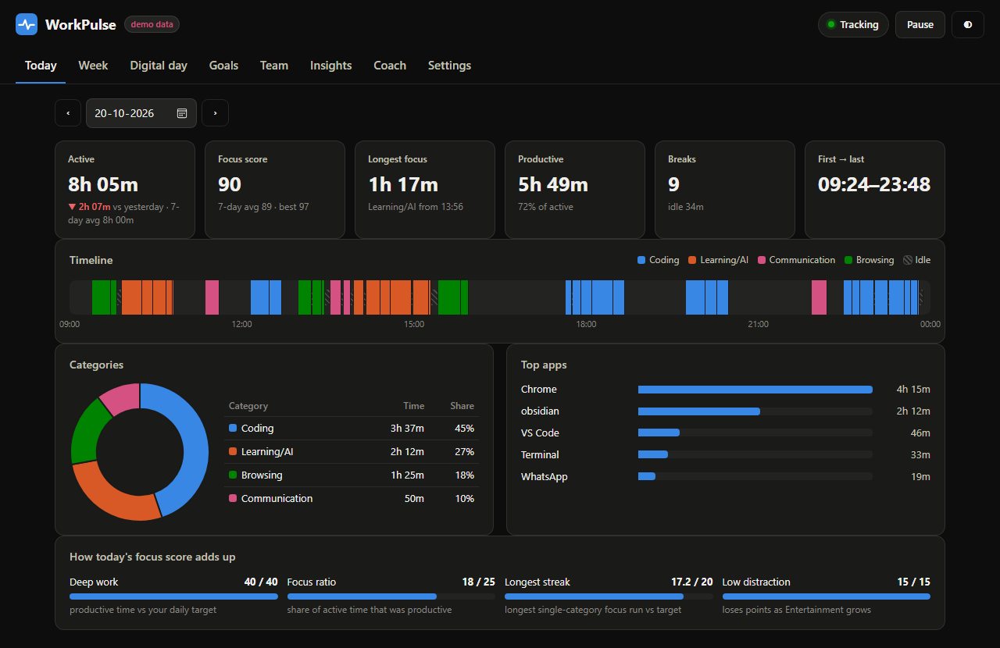
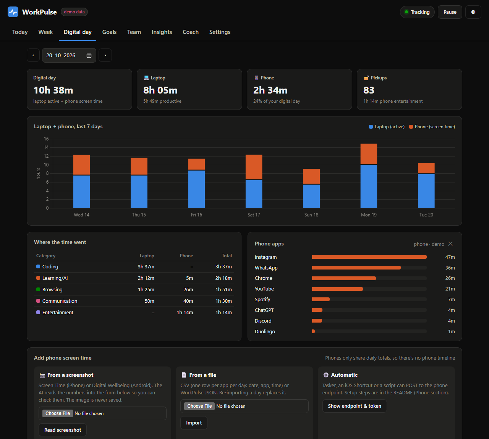
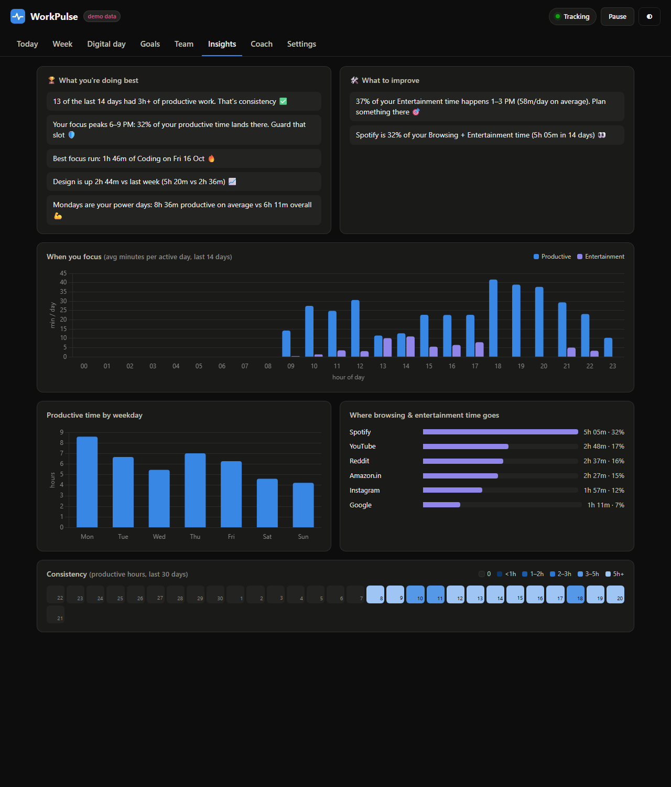
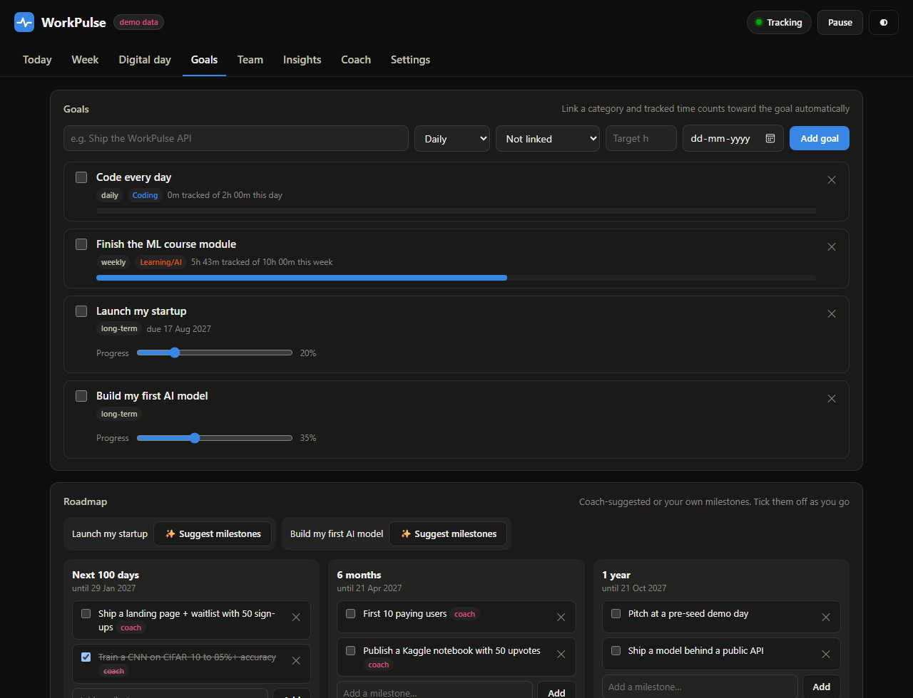
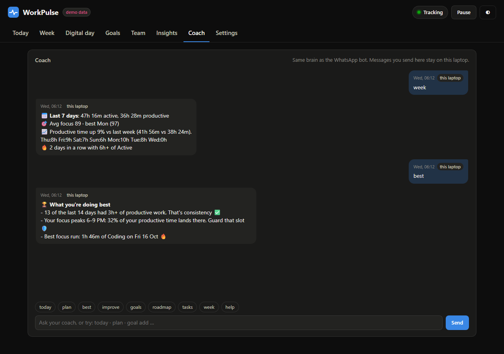

# WorkPulse 🫀

**A private laptop activity tracker with a WhatsApp coach.** It quietly notes whether you're *active, idle or away* and which app you're in, then tells you how your day actually went: focus score, best hours, what to improve, your goals and your team's tasks, on a local dashboard and in short WhatsApp messages.

Everything stays on your laptop. No keylogging, no screen capture. [Privacy details →](docs/privacy.md)



| | |
|---|---|
|  |  |
|  |  |

<sub>Screenshots use the built-in demo data. More: [Week](docs/screenshots/week.png) · [Team](docs/screenshots/team.png)</sub>

## What it does

- **Tracks your laptop** every 5 s: active / idle / away, app and category (Coding, Learning/AI, Design, Content Creation, Communication, Browsing, Entertainment). Back-dates idle time so nothing is padded, records sleep as away, pauses instantly.
- **Scores your day** (0–100) with a transparent formula, finds your longest focus streak, compares with yesterday, your 7-day average and your best day, and spots multi-day streaks.
- **Coaches you on WhatsApp:** morning priorities, a midday check, a night report, a Sunday review, gentle nudges and task reminders. Chat back with commands (`today`, `plan`, `goal add …`) or free text, answered by an AI coach that only uses your real numbers.
- **Plans with you:** goals that count tracked time automatically, a 100-day / 6-month / 1-year roadmap with coach-suggested milestones, and a team board with tasks, meetings and collaboration share.
- **Standalone Android app:** a full phone tracker that works on its own (no laptop needed): screen time, pickups, balance score, trends, focus timer with distraction report, app limits, bedtime reminder and habits. [Android app →](docs/android-app.md)
- **On your phone too:** a mobile dashboard over your home Wi-Fi (and from anywhere through your own Tailscale network), and an Android app that tracks your phone usage automatically and syncs it to the laptop. [Mobile guide →](docs/mobile.md)
- **Shows the full picture:** specific insights ("your focus peaks 6–9 PM", "37% of your Entertainment happens 1–3 PM"), plus phone screen time merged into one **digital day**.

## Quick start (Windows)

You need [Python 3.11+](https://www.python.org/downloads/) (tick *Add python.exe to PATH*). Then, in the project folder:

```bat
scripts\install.cmd
```

That installs everything, runs a health check, offers to start WorkPulse at login, adds a **WorkPulse Dashboard** shortcut to the Start Menu, and starts tracking. Open **http://127.0.0.1:8787**.

Want to see it with data right away, without waiting a day?

```bat
.\workpulse demo seed
```
```bat
.\workpulse --demo serve --port 8788
```

Then open http://127.0.0.1:8788. Demo data lives in a separate database; your real data is never touched.

## Everyday commands

| | |
|---|---|
| `.\workpulse today` | Today's stats in the terminal |
| `.\workpulse pause` / `resume` | Privacy switch (also in the dashboard and on WhatsApp) |
| `.\workpulse dashboard` | Open the dashboard |
| `.\workpulse doctor` | Check that everything works; prints a fix for each problem |
| `.\workpulse start` / `stop` | Start or stop the tracker + dashboard (kept running by a supervisor) |
| `.\workpulse panel` | Dashboard docked to the side of the screen (`--left`, `--width`, `--float`, `--close`) |
| `.\workpulse lan on` then `.\workpulse connect` | Let your phone connect over Wi-Fi, then pair it (`remote on`: also when you're out, via Tailscale) |

All commands: [docs/commands.md](docs/commands.md)

## Guides

| Guide | What's in it |
|---|---|
| [Setup, upgrades & maintenance](docs/setup.md) | Install, auto-start, upgrade (re-run the installer), backups, logs, uninstall |
| [WhatsApp bot & AI coach](docs/whatsapp.md) | 10-minute Twilio sandbox setup, what the bot sends, chat commands, AI coach and cost |
| [Android app](docs/android-app.md) | The standalone phone tracker: install, features, privacy |
| [Mobile app](docs/mobile.md) | Phone dashboard over Wi-Fi, pairing, the Android app with automatic phone tracking |
| [Phone tracking](docs/phone.md) | Screenshot / manual / CSV / ADB / Tasker / iPhone Shortcut, and honest limits |
| [Dashboard, focus score & goals](docs/dashboard.md) | Every tab, the score formula, how goals count tracked time |
| [Privacy](docs/privacy.md) | What's recorded, what never is, what (optionally) leaves the laptop, deleting data |
| [How it works](docs/architecture.md) | Architecture diagram, configuration, API & security, development |
| [Troubleshooting](docs/troubleshooting.md) | Common problems and fixes |
| [Future ideas](docs/future-ideas.md) | What could come next |
| [Acceptance checks](docs/acceptance.md) | What was verified, and how |

## Privacy in one paragraph

WorkPulse records timestamps, active/idle/away state, the app name, a category and (optionally, on by default) the window title, with a never-log list for banking, incognito and password managers. It never records keys, typed text, screenshots or screen contents: it only asks Windows how long it's been since the last input. Data lives in `data/workpulse.db` on this laptop. The dashboard is reachable only from this laptop. WhatsApp and the AI coach are optional, and send only what [privacy.md](docs/privacy.md) lists.

## Keys and secrets

No keys are in this repository. Each install supplies its own:
- **Laptop:** copy `.env.example` to `.env` and fill in only what you use (Anthropic key for the AI coach, Twilio for WhatsApp). `.env`, your database and logs (`data/`) are in `.gitignore` and never leave your machine.
- **Android app:** each person pastes their own Gemini key in the app (More → AI coach); it stays on the phone. Never build a key into an APK you share.
- **Before pushing:** run `.venv\Scripts\python scripts\check_secrets.py`. It scans exactly what git would publish and fails if anything looks like a key or token. If a real key ever gets committed, rotate it; deleting the file doesn't remove it from history.

## Version

1.3.0. See [CHANGELOG.md](CHANGELOG.md). Built for Windows 11; macOS/Linux support is written but untested.
