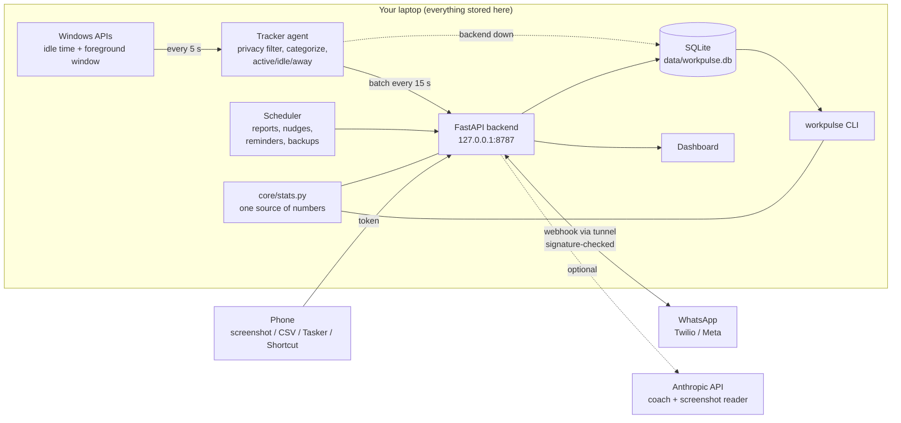

# How WorkPulse works

[← Back to README](../README.md)

## Overview



The CLI, the API, the WhatsApp reports and the coach's fact sheet all call the same `workpulse/core/stats.py`, so their numbers always match. A test checks this, and it was verified live.

- **States:** `active` = input in the last 2 min · `idle` = no input 2–10 min · `away` = no input > 10 min, screen locked, or the laptop was asleep. All thresholds are in `config.yaml`.
- **Back-dating:** idle is only *detected* after 2 min, but you really stopped at your last input, so active sessions end at the last input. Active time isn't padded.
- **Sleep/shutdown:** if two samples are far apart (sleep, hibernate), the gap is logged as `away`. The open session is saved every 15 s, so a hard power-off loses at most 15 s.
- **Categories:** Coding, Learning/AI, Design, Communication, Browsing, Entertainment, Content Creation, Other. App → category mapping and browser **title rules** (e.g. "YouTube + tutorial" → Learning/AI, plain YouTube → Entertainment) live in `config.yaml`.

## Configuration

- `config.yaml`: thresholds, privacy, categories, scoring, agent mode, server port. The running tracker reloads it within ~10 s (server port changes need `.\workpulse stop` then `.\workpulse start`).
- `data/settings.yaml`: what you change in the dashboard's Settings tab. Only fields you actually change are stored there, merged on top of `config.yaml`, so your hand-written file (and its comments) is never rewritten. Delete it to go back to `config.yaml` only.
- `agent.mode` (default `auto`): the tracker posts batches to the backend; if the backend isn't running it writes straight to the local DB; if that fails too it buffers to `data/outbox.jsonl` and retries, also after a restart.
- `.env`: secrets (Twilio / Meta for WhatsApp, `ANTHROPIC_API_KEY` for the coach) and `WORKPULSE_LOG_LEVEL`. Tracking and the dashboard need nothing from it. See `.env.example`.

## API & security

Interactive docs at http://127.0.0.1:8787/api/docs. Main endpoints: `GET /api/status`, `GET /api/day?date=YYYY-MM-DD`, `GET /api/week?end=…`, `GET/PUT /api/settings`, `POST /api/pause|resume`, `GET /api/export.csv`, `POST /api/wipe` (`{"confirm":"DELETE"}`), `POST /api/ingest/sessions` (agent only). Phase 4: `/api/goals`, `/api/roadmap` (+ `/milestones`, `/suggest`), `/api/team` (+ `/members`), `/api/tasks`, `/api/meetings`, `/api/insights`, `/api/messages`, `POST /api/chat`. Phase 5: `POST /api/phone/ingest` (phone token), `/api/phone/import`, `/api/phone/manual`, `/api/phone/screenshot`, `/api/phone/setup`, `DELETE /api/phone/day`, `GET /api/digital?date=`.

Local-only hardening (it's your machine, but your browser visits random sites):
- Binds to `127.0.0.1`, and rejects requests whose `Host` isn't `localhost`/`127.0.0.1` (blocks DNS-rebinding tricks).
- Agent ingest needs the secret in `data/agent.token`.
- Dashboard actions (pause, settings, wipe) need an `X-WorkPulse-UI` header, which other websites can't send to localhost (the CORS preflight is never approved).
- The server re-applies `capture_titles: false` on ingest; window titles are rendered as text, never as HTML.
- A `--demo` server refuses real ingest, so demo and real data never mix.
- Through a tunnel, only the WhatsApp webhooks (signature-checked) and `/api/phone/ingest` (phone token, checked before the body is read) are reachable.

## Development

```bat
.venv\Scripts\python -m pytest -q
```

Project layout:
```
workpulse/
  agent/        tracking loop, pause/autostart control, platforms/ (windows, macos, linux)
  core/         models, state machine, categorizer, stats + focus score, SQLite, demo data
  backend/      FastAPI app: app.py (stats, settings, webhooks), planning.py (goals, roadmap, team, insights, chat)
  bot/          WhatsApp providers, commands, AI coach, reports, scheduler, roadmap, screenshot reader
  cli.py        `workpulse` command
  logs.py       rotating log files in data/logs
dashboard/      index.html, style.css, app.js (Today/Week/Settings), planning.js (Goals/Team/Insights/Coach), phone.js (Digital day). No build step
docs/           these guides + screenshots/
scripts/        install (also upgrades) / run / uninstall / screenshots
tests/          state machine, categorizer, stats, DB + migrations, API, agent sinks/outbox, trends, bot, goals/roadmap/team/insights, phone
```
Defaults chosen (change any in `config.yaml`): Run-key autostart; titles captured by default; data in `./data`; demo data in a separate DB; dashboard on port 8787; agent in `auto` mode; Chart.js pinned to 4.4.1 from a CDN.

Regenerate the README screenshots (from demo data only) with `powershell -ExecutionPolicy Bypass -File scripts\screenshots.ps1`.
