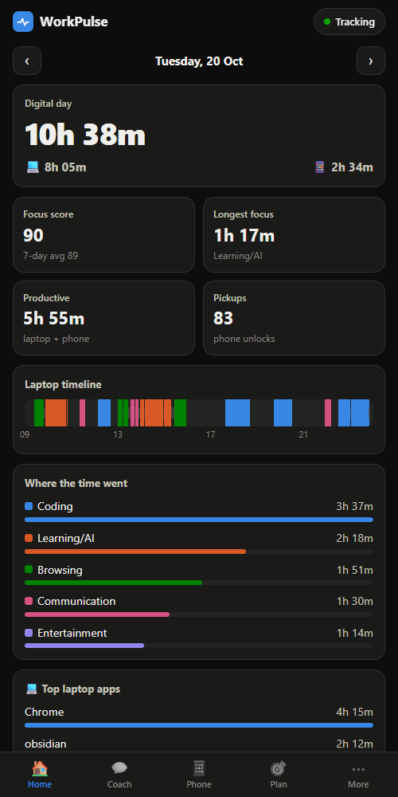
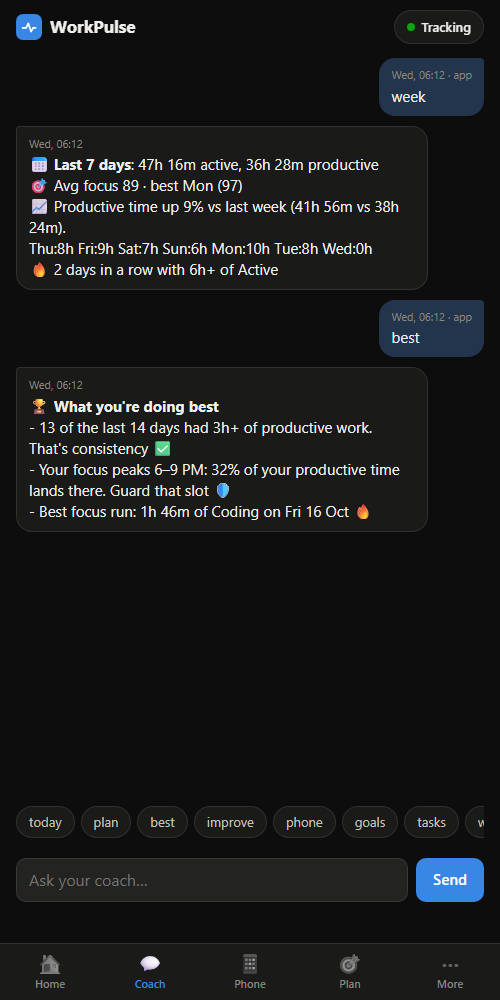
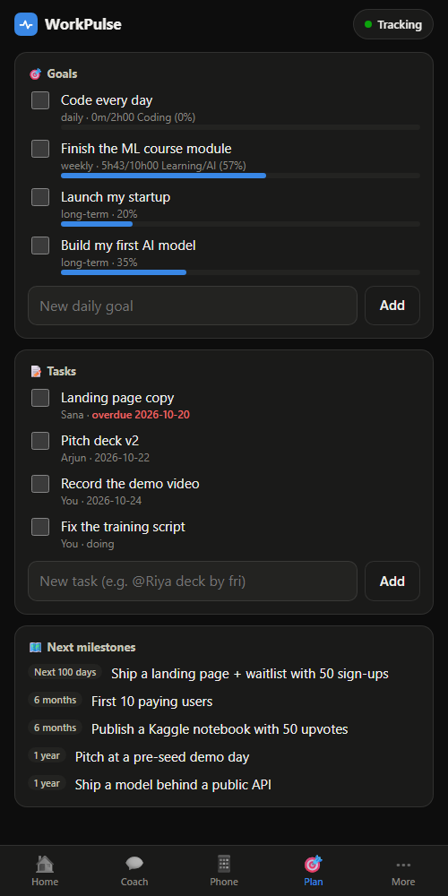

# Mobile app (phone dashboard + Android tracking)

[← Back to README](../README.md)

> **Just want to track your phone?** The Android app now works entirely on its own, with no laptop needed: see [Android app](android-app.md). This page is about connecting the phone to WorkPulse on a laptop.

<p>
  
  
  
</p>

Two ways to use WorkPulse on your phone, both talking straight to your laptop: over your **home Wi-Fi**, and optionally **when you're out** through Tailscale, your own private network ([section 4](#4-when-youre-out-tailscale)). Your data is never stored anywhere but the laptop.

| | Mobile web app | Android app |
|---|---|---|
| What | Opens in the phone's browser at `http://<laptop-ip>:8787/m/`; add it to your home screen | An installable app (`workpulse.apk`) that shows the same mobile dashboard |
| Dashboard (laptop + phone digital day, timeline, apps) | ✅ | ✅ |
| Coach chat (same brain as WhatsApp) | ✅ | ✅ |
| Goals, tasks, roadmap, pause switch | ✅ | ✅ |
| **Automatic phone tracking** (which apps, how long, unlocks) | ❌ (browsers can't see other apps) | ✅ every 15 min |
| Works on iPhone | ✅ (dashboard only) | ❌ (Android only; iOS never lets apps read Screen Time) |

## 1. Let phones reach the laptop

```bat
.\workpulse lan on
```
(or dashboard → **Settings → Connect a phone** → tick *Let paired phones on my Wi-Fi connect*). It prints the address for your phone, e.g. `http://192.168.1.20:8787/m/`.

Windows usually needs two one-time changes:
- **Network profile → Private.** Settings → Network & internet → Wi-Fi → your network → *Network profile type: Private*. On "Public", Windows blocks phones from connecting. `.\workpulse doctor` tells you if this is the problem.
- **Allow Python through the firewall.** When Windows shows *"Windows Defender Firewall has blocked some features of Python"*, tick **Private networks** and click **Allow**. If you clicked Cancel earlier: Windows Security → Firewall & network protection → *Allow an app through firewall* → find Python (`pythonw.exe`) → tick Private.

Using a VPN (e.g. Proton VPN)? Turn on its **Allow LAN connections** option, or pause it, or the phone can't see the laptop.

## 2. Pair your phone (once)

Dashboard → **Settings → Connect a phone → Show a pairing code** (or `.\workpulse connect` in the terminal). You get a 6-digit code and two QR codes:
- **Phone camera** QR → opens the mobile web app with the code filled in → tap **Connect**.
- **Android app** QR → opens the Android app with the address and code filled in.

Codes last 10 minutes and work once. Each phone gets its own token; remove a phone any time in the same Settings card (or `.\workpulse devices --remove <#>`) and it's cut off immediately.

## 3. Get the Android app

1. Build it on the laptop (first time downloads ~1.5 GB of official Android tools into `%LOCALAPPDATA%\WorkPulse-android`, no admin needed):
   ```bat
   powershell -ExecutionPolicy Bypass -File scripts\build-android.ps1
   ```
   This puts `workpulse.apk` where your phone can download it.
2. On the phone, open the mobile web app → **More → Get the Android app**, and open the downloaded file. Android asks to allow installs from your browser ("unknown apps") the first time; allow it for this install.
3. Open **WorkPulse**, scan the **Android app** QR from the laptop (or type the address + code), then tap **Open settings** and allow **Usage access** for WorkPulse.

That's it: the app syncs your phone usage every 15 minutes while it can reach the laptop. If it can't (you're out without Tailscale, laptop asleep), Android keeps the usage history and the next successful sync sends every day since the last one, up to a week back (re-sending replaces, never doubles).

## 4. When you're out (Tailscale)

To use the app and keep syncing when you're **not** on home Wi-Fi, connect your phone and laptop with [Tailscale](https://tailscale.com): a free private network (WireGuard VPN) between your own devices. Why this and not a public link:
- **Nothing is opened to the internet.** No port forwarding, no public URL. Only devices signed in to *your* Tailscale account can even reach the laptop, and they still need their WorkPulse pairing token.
- **Data still goes only phone → laptop**, end-to-end encrypted. Tailscale's servers only help the two devices find each other; they never see or store your activity data. (A tunnel like ngrok or Cloudflare would put a public URL in front of your data; WorkPulse deliberately refuses tunneled requests for anything but the webhooks.)
- Works on mobile data and any Wi-Fi, and the laptop's Tailscale address never changes.

Setup (once):
1. Install Tailscale on the laptop ([tailscale.com/download](https://tailscale.com/download)) and sign in.
2. Install **Tailscale** on the phone (Play Store / App Store), sign in with the **same account**, and switch it on.
3. On the laptop: `.\workpulse remote on` (or dashboard → Settings → Connect a phone → tick *Also when I'm out (via Tailscale)*). It prints the away address, e.g. `http://100.101.102.103:8787/m/`.
4. Already-paired Android app: nothing to do. It learns the new address at its next sync while on home Wi-Fi (or pair again; the app QR now carries both addresses).

The Android app then tries home Wi-Fi first and falls back to Tailscale on its own. The web app on an iPhone/browser is tied to one address: when you're out, open the away address (pair it once there too, with a fresh code).

If the phone can't connect over Tailscale but Tailscale shows both devices online, Windows may treat the Tailscale network as *Public*: `.\workpulse doctor` tells you, and the fix is to allow Python on Public networks in Windows Firewall (WorkPulse itself still only accepts Tailscale and home-network addresses). Turn it off any time with `.\workpulse remote off`. The laptop must be awake and WorkPulse running (it is, with auto-start) for the phone to reach it.

### What the Android app reads and sends
- From Android's usage stats: which app was in the foreground, from when to when, and phone unlocks. **Never** screen contents, messages, notifications, typing or anything inside apps.
- Apps on your never-log list (`privacy.exclude_apps` / `exclude_keywords` in `config.yaml`, e.g. banking and payment apps) are stored on the laptop only as **(private)**: their time counts, their name doesn't. Add a keyword (dashboard → Settings → Privacy) and already-stored phone data is cleaned too.
- **Pickups are approximate:** they count unlocks; phones without a secure lock screen (or some OEM builds) don't report unlocks, so screen-ons are counted instead.
- Apps are sorted by `config.yaml → phone.apps` first, then by Android's own category (games, video, social → Entertainment; news → Browsing).
- It sends per-app minutes per day + unlock count to your laptop's `/api/phone/ingest` (home Wi-Fi or Tailscale address), nowhere else.
- It needs *Usage access* (for the numbers), *Query all packages* (to show "Instagram" instead of `com.instagram.android`) and *Internet* (to reach the laptop).

## Security model
- Wi-Fi access and away access are both **off by default** and separate. Wi-Fi access lets in private (home-network) addresses only; away access lets in Tailscale addresses (100.64.0.0/10) only. The Host header must be an IP address (or, over Tailscale, your `*.ts.net` name), which blocks DNS-rebinding tricks. Public internet addresses are always refused.
- Without a paired token a phone can open only the app's static files and the pairing endpoint. Pairing needs the code currently shown on the laptop; 5 wrong tries kill the code.
- Paired phones can view everything and pause/resume, chat, and add goals/tasks/phone data. They **can't** change settings, wipe data, see the phone/agent tokens, pair more phones or turn Wi-Fi access off; those stay laptop-only.
- Tokens are stored hashed on the laptop.
- **Limitation:** traffic on your Wi-Fi is plain `http` (no TLS), like most home devices. On your own home Wi-Fi that's fine; **turn Wi-Fi access off on shared or public networks** (college, café): `.\workpulse lan off`.

## Troubleshooting
- **Phone says "Can't reach the laptop":** same Wi-Fi (or Tailscale switched on, on both)? laptop awake? `.\workpulse doctor` → *Phone app* line shows Public-network or VPN problems. Some routers have "AP/client isolation" (common on guest networks) that blocks device-to-device traffic; use the main network.
- **"This phone isn't paired anymore":** it was removed on the laptop, or you reset the app. Pair again with a new code.
- **Android app shows no phone data:** More/Phone tab → is Usage access allowed? Tap **Sync now**. The Phone tab shows the last sync time and the last error.
- **Updating the app:** rebuild with `scripts\build-android.ps1` and install the new APK over the old one. Android only accepts the update if it's signed with the same key; the build script keeps a backup of that key in `%LOCALAPPDATA%\WorkPulse-android\debug.keystore.backup` (back it up if you reinstall Windows). If the key is ever lost, uninstall the app and install the new one; your data lives on the laptop, so nothing is lost.
- **Laptop's IP changed** (router restarted): Android app → *Change laptop address*, enter the new address and a fresh code. To avoid this, give the laptop a fixed IP (DHCP reservation) in your router settings.
